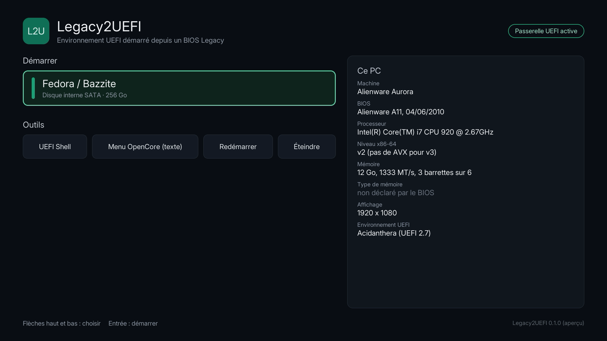

# Legacy2UEFI

A universal USB key that gives BIOS-only x86-64 PCs a software UEFI environment (OpenDuet), with a graphical
boot screen, so that UEFI-only operating systems can be installed and booted — without touching the firmware,
and without Legacy2UEFI writing to internal disks.

*The Legacy2UEFI boot screen on a BIOS-only Alienware Aurora R1: arrow keys to choose, Enter to boot — nothing
starts on its own.*

Status: **0.1.0-alpha.3** — verified on an Alienware Aurora R1 (Bazzite) and a Lenovo ThinkPad 4414WBF (Omarchy).
Requires a USB keyboard. See [docs/releases/](docs/releases/).

Start here:
- [agent.md](agent.md) — current state, invariants, next safe action
- [docs/experiments/](docs/experiments/) — hardware tests E1–E4
- [docs/adr/](docs/adr/) — architecture decisions
- [docs/SECURITY.md](docs/SECURITY.md) — threat model (draft)
- [docs/BOOTFLOW.md](docs/BOOTFLOW.md) — diagrams

Build a key image (Windows workstation): `tools/release/build-release.ps1 -Version <x.y.z>`.

## Licence

Source: https://github.com/loganxwolverine/Legacy2UEFI

Legacy2UEFI is free software: you can redistribute it and/or modify it under the terms of the GNU General
Public License as published by the Free Software Foundation, either version 3 of the License, or (at your
option) any later version. See [LICENSE](LICENSE). Third-party components and their licences:
[THIRD-PARTY-NOTICES.md](THIRD-PARTY-NOTICES.md).

Build the bridge. Document the bridge. Test the bridge.
Never pretend the bridge exists where it has not been proven.
