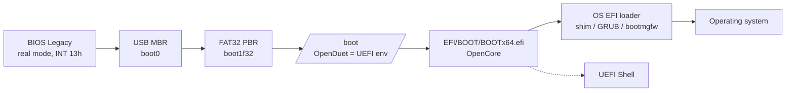
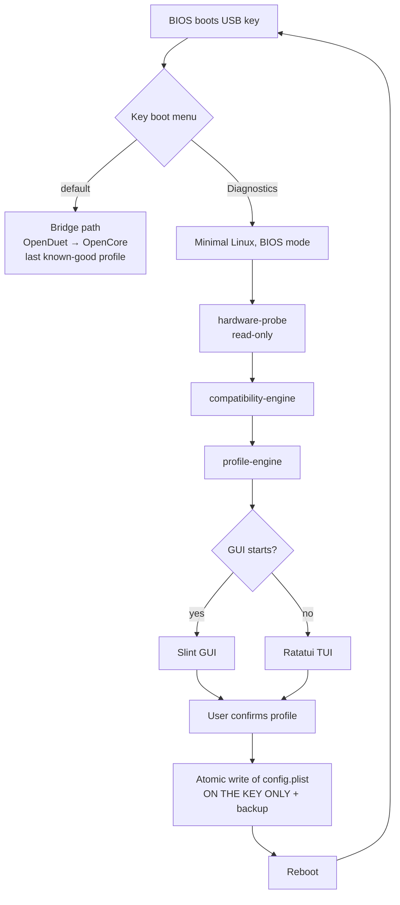
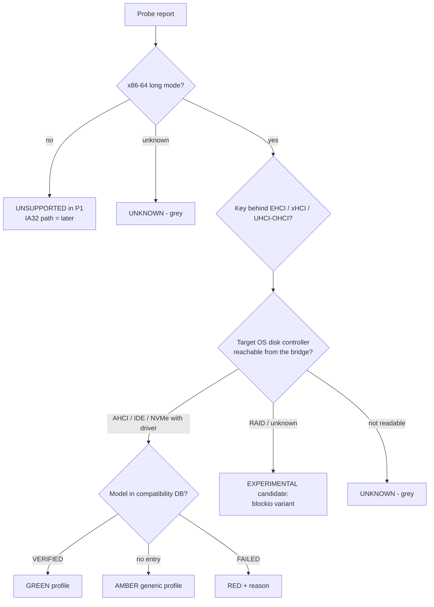
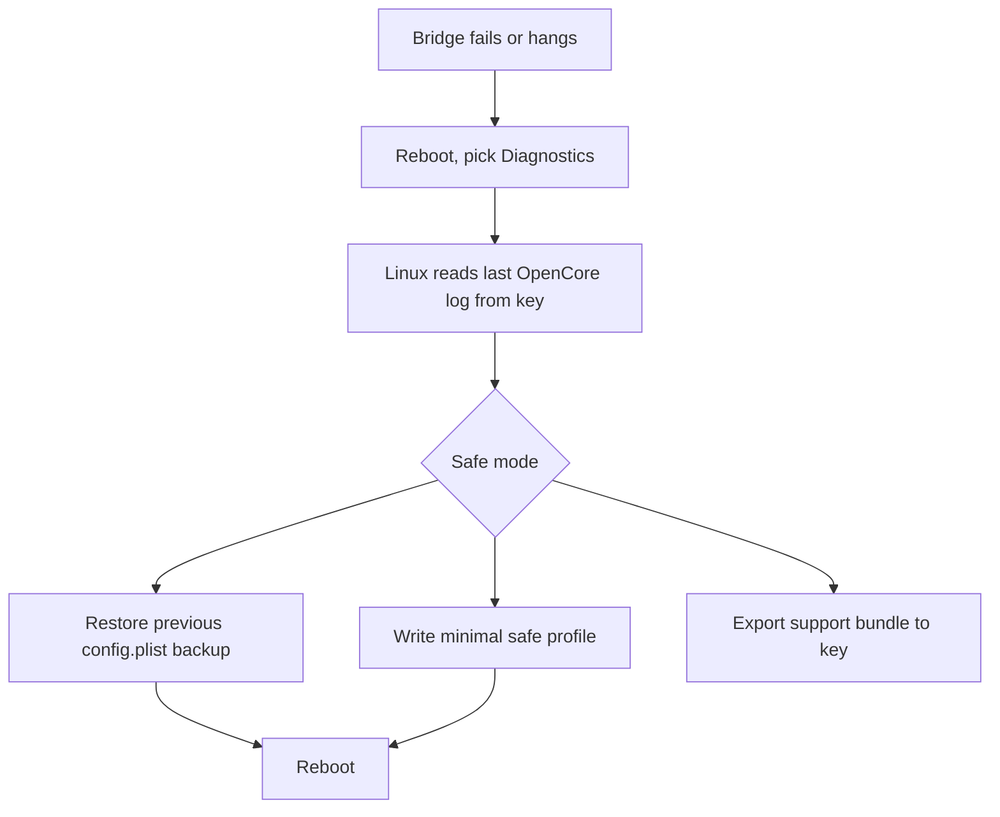
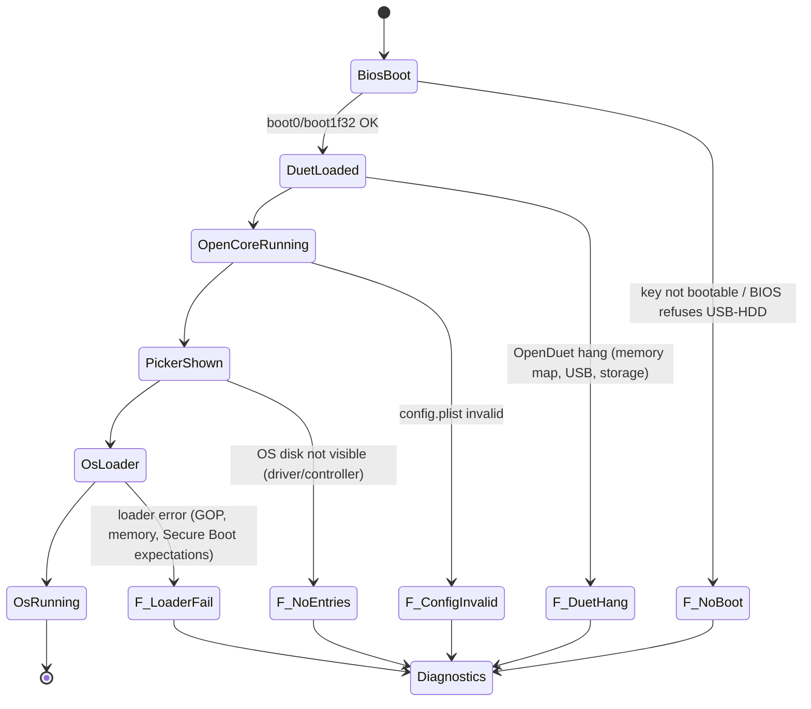
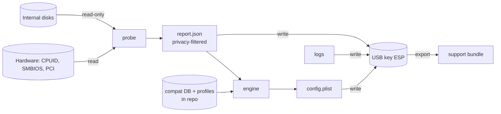

# Boot flow and decision diagrams

Mermaid, versioned with the code. Status: **PROPOSED** (ADR-0002). Nothing here is proven yet
beyond what the golden reference demonstrated outside this repo.

## 1. Boot chain (bridge path)

## 2. Two-stage architecture

## 3. Profile selection / hardware decision tree

## 4. Recovery flow

## 5. Failure states

## 6. Data flow and trust

