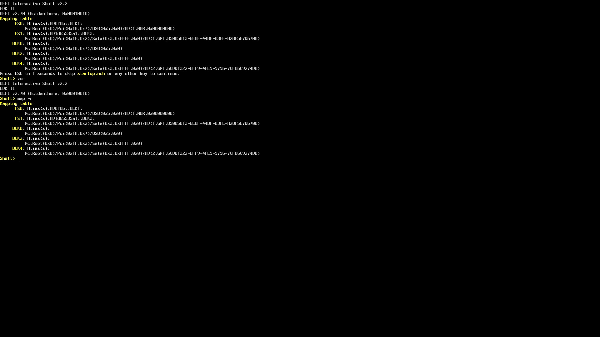

# 2026-11-19 — démarrage du projet

## Fait

- Installation des skills externes : `rust-best-practices`, `security-threat-model`, `uml-and-software-architecture-visualization`.
- Livrable P0 : `agent.md`, quatre skills Legacy2UEFI (brouillons), ADR 0001–0005, modèle de menaces, schémas, audit.
- Projet déplacé dans `Documents\Legacy2EFI`.
- Clé Unraid sauvegardée (`Documents\Sauvegarde-cle-UNRAID-2026-11-19`, 72 fichiers vérifiés), puis transformée en clé de test **L2U-E1** : OpenDuet + OpenCore 1.0.7.

## Essais sur l'Alienware Aurora R1

**Essai 1** — le menu OpenCore s'affiche, mais le clavier USB ne répond pas (seul le pilote PS/2 était chargé).

**Essai 2** — avec le pilote `OpenUsbKbDxe`, le clavier USB fonctionne et le UEFI Shell répond.

## Décisions

- Clavier USB par défaut, PS/2 seulement en secours automatique (ADR-0006).
- L'Aurora R1 devient la machine de test principale ; le Dell est différé.
- Nouvelle mission : clé universelle, aucun système requis, installation de systèmes UEFI comme Bazzite.
- La clé reste branchée après l'installation (ADR-0007).
- Écran de démarrage graphique proposé, avec les caractéristiques du PC (ADR-0008).
