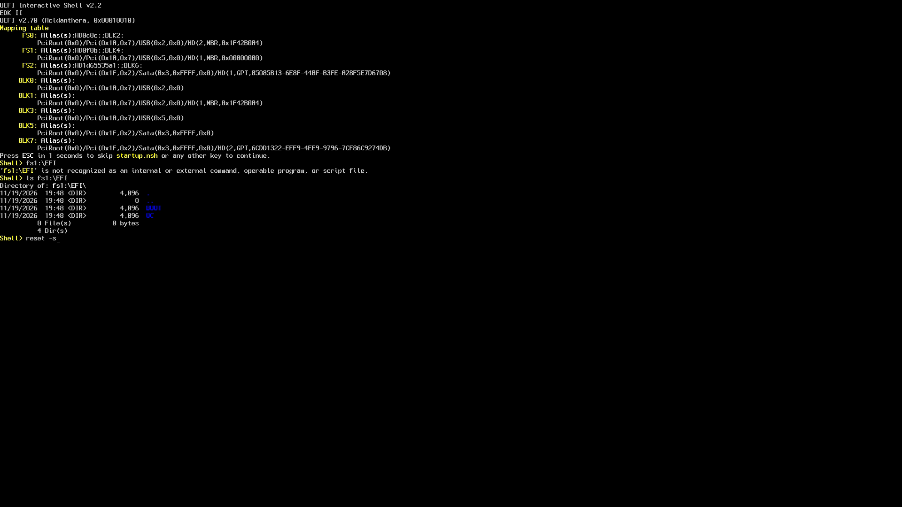
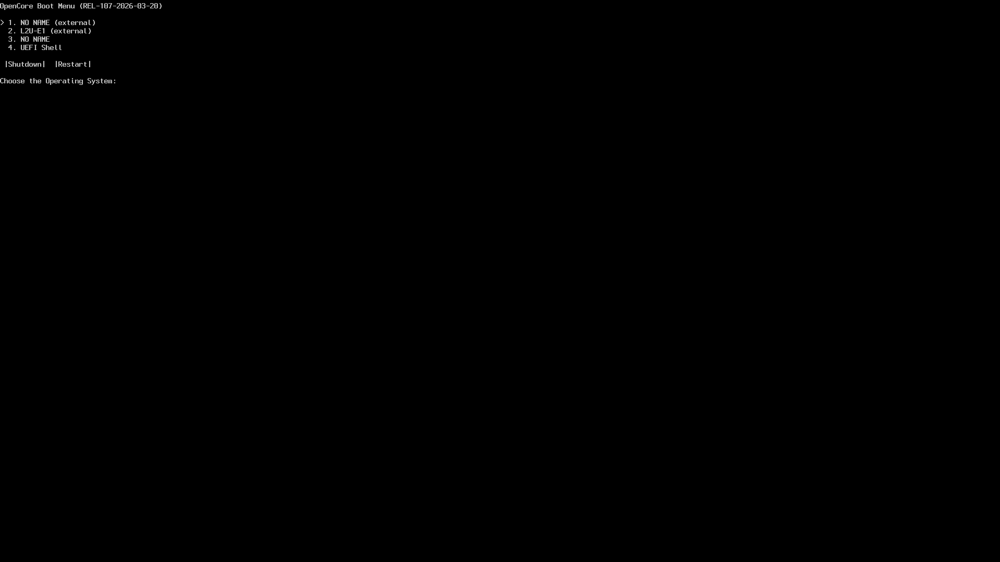
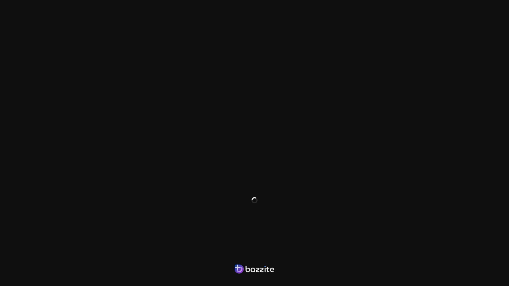
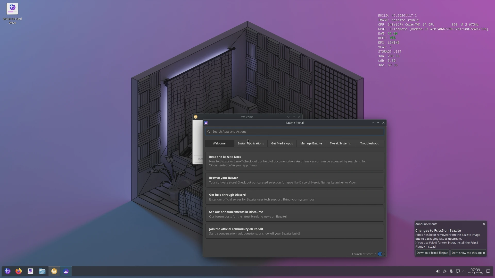
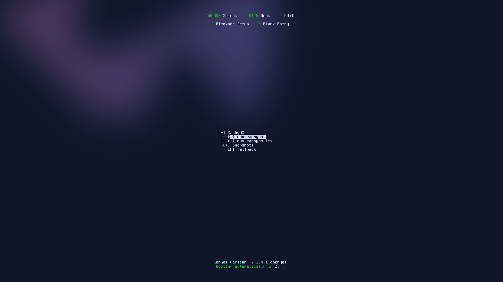
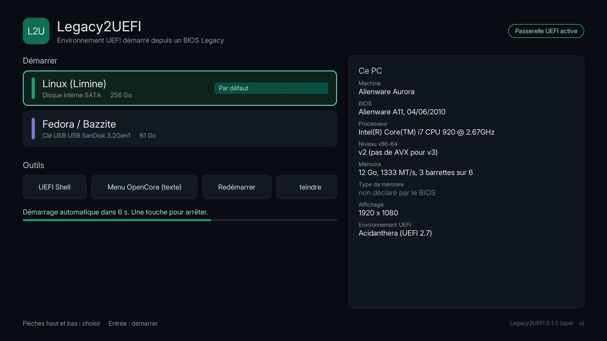
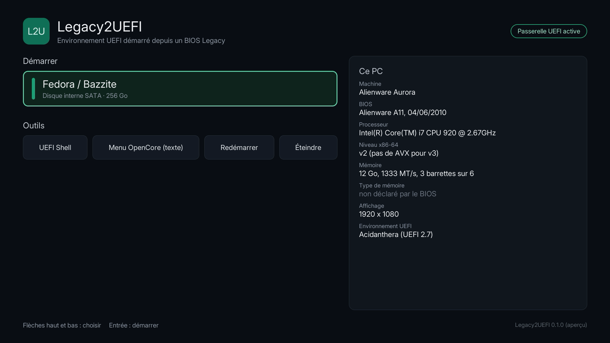
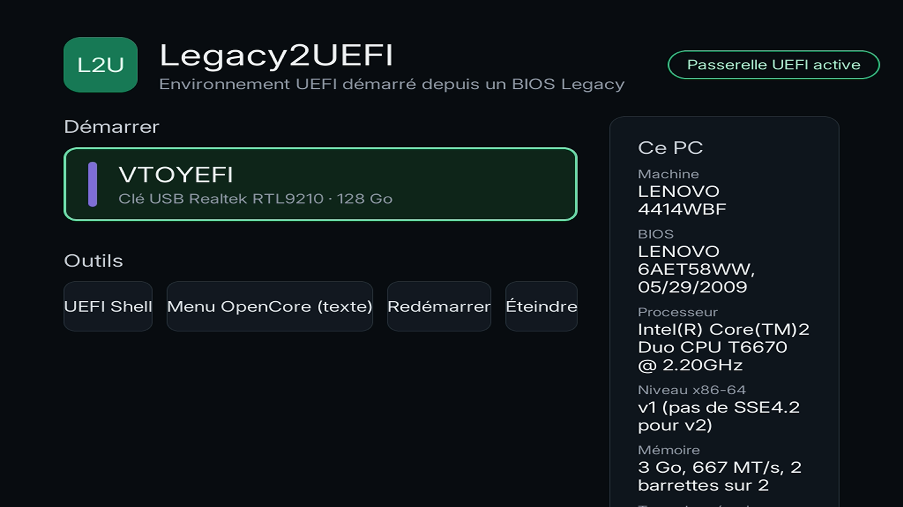
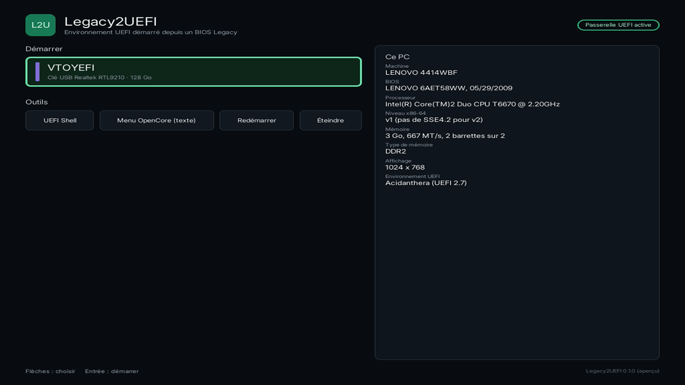
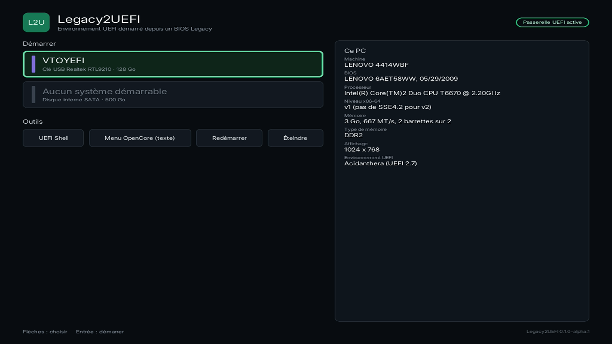

# 2026-11-20

## Essai 3 sur l'Alienware Aurora R1

- Deux clés branchées : la passerelle voit **L2U-E1** et une clé **Ventoy** (`VTOYEFI`).
- `ls fs1:\EFI` a listé notre propre clé : les numéros `fsN` changent quand on ajoute une clé.
  À retenir : un disque interne se reconnaît à `Sata(…)` dans son chemin.

## Journal OpenCore vide : expliqué

La version RELEASE d'OpenCore n'écrit que les erreurs et avertissements. Un démarrage sans erreur ne laisse
rien. Pour avoir de vrais journaux, il faut la version DEBUG (téléchargement à valider).

## Obsidian

Le dossier du projet est utilisé comme coffre Obsidian. Note d'accueil : `Legacy2UEFI.md`.

## Prochaine étape

E2 : démarrer l'installateur de Bazzite depuis la clé Ventoy, à travers la passerelle, sans rien installer.

## E2 réussie : Bazzite démarre en UEFI sur un PC BIOS

La méthode Ventoy n'a pas fonctionné. Avec une clé Bazzite flashée directement, ça marche :
menu OpenCore → `NO NAME (external)` (la clé Bazzite) → écran Bazzite → bureau Live.

Bazzite affiche lui-même : i7 920, Radeon RX 4xx/5xx, 12 Go, **UEFI: YES**. Rien n'a été installé.

## Rapport de la session Live (script `l2u-check.sh`)

Lancé sans rien recopier, grâce au script posé sur la clé. Ce qu'il montre :

- Linux voit un vrai **UEFI 64 bits** (« EFI v2.7 by Acidanthera ») avec ses services, et peut lire les variables UEFI.
- Aurora R1 : BIOS A11 de 2010, carte X58, i7-920, 3 barrettes de 4 Go à 1333 MT/s, Radeon RX 4xx/5xx.
- Le vieux BIOS déclare la mémoire comme « Other » au lieu de DDR3 : l'écran graphique ne pourra pas lire le type DDR, seulement le déduire.
- Le clavier USB est sur un port USB 1.1 : il marche quand même sous la passerelle.
- Le disque interne contient déjà un Linux (partition EFI de 4 Go + btrfs).

Rapport complet : `tests/evidence/alienware-aurora-r1/2026-11-20/l2u-report-20261120-074515.txt`.

Deux risques à préparer avant d'installer (E3) : l'entrée de démarrage enregistrée par l'installateur risque
de ne pas survivre à l'extinction, et une boucle de redémarrage est possible avec le chargeur de secours de Fedora.

## Recentrage : seulement la clé

Règle posée : tout l'effort va à la clé. Le contenu des disques et les installations relèvent de l'utilisateur.

## La clé sait retrouver les Linux installés

Ajout de `BlessOverride` dans la config OpenCore : une liste de 13 emplacements de chargeurs Linux courants
(Fedora/Bazzite, Ubuntu, Debian, openSUSE, Arch, systemd-boot…), cherchés sur tous les disques.
La clé n'a plus besoin de la mémoire UEFI pour trouver un système installé. Vérifié par `ocvalidate`, pas encore testé sur l'Aurora.

## Système installé sur le disque interne

L'entrée « NO NAME » lance le menu Limine d'un CachyOS installé : la clé démarre bien un système installé.
Mais CachyOS redémarre, sur ses deux noyaux, alors que Bazzite démarre sans problème par la même clé.
Cause probable : CachyOS optimisé x86-64-v3 sur un i7-920 qui n'est que v2. Ce n'est pas un défaut de la clé.
Idée produit : la clé affichera le niveau x86-64 du processeur.

## Écran graphique : première version sur la clé

- Rust 1.100 installé (cible UEFI), plus WinLibs MinGW dans `%USERPROFILE%\.l2u-tools` (outils de compilation Windows).
- Programme `l2u-launcher.efi` (537 Ko) écrit en Rust avec Slint : affiche les caractéristiques mesurées du PC
  (machine, BIOS, processeur et son niveau x86-64, mémoire, affichage, environnement UEFI).
- Ajouté au menu OpenCore sous le nom **Legacy2UEFI**. Entrée ou Échap : retour au menu.
- Pas encore testé sur l'Aurora.

## Écran graphique v0.2 : il devient le menu de démarrage

Retour sur la v0.1 : texte illisible (sortie en 4K) et mauvaise approche (une application lancée depuis OpenCore).
Nouvelle version : l'écran Legacy2UEFI est le **premier programme de la clé**. Il force le 1920×1080, charge le
pilote clavier USB, cherche les systèmes et les clés démarrables, affiche le tout avec les caractéristiques du PC
et démarre le choix. Le système interne démarre seul après 10 s. OpenCore reste disponible en secours (« Menu OpenCore »).
Pas encore testé sur l'Aurora.

## Écran v0.3

Le test de la v0.2 n'a pas affiché l'écran graphique (repli sur un menu texte, clé Bazzite absente). La v0.3 écrit
un journal sur la clé (`L2U-LAUNCHER-LOG.txt`) pour savoir exactement où ça casse, nomme les périphériques
(« Clé USB SanDisk Ultra Fit · 57 Go », « Disque interne SATA · 238 Go », « CachyOS ») et liste tous les disques.

## L'écran graphique s'affiche au démarrage

Premier vrai succès de l'écran : en 1080p dès l'allumage, avec le disque interne et la clé Bazzite SanDisk.
Défauts corrigés dans la v0.3.1 (lettres accentuées manquantes, « USB USB », badge trop large, nom CachyOS).
- Écran : plus de démarrage automatique, l'écran attend le choix de l'utilisateur (décision du propriétaire).

## E3 réussie : Bazzite installé et démarré grâce à la clé

Installation de Bazzite sur le disque interne de l'Aurora R1 depuis la session Live lancée par la clé, puis
redémarrage : l'écran Legacy2UEFI affiche « Fedora / Bazzite · Disque interne SATA · 256 Go », et Bazzite démarre.
« Tout est ok. » Première machine **VERIFIED** du projet.

Menu OpenCore : l'entrée « Legacy2UEFI » faisait doublon avec « L2U-E1 (external) » (même programme) ; supprimée.

## La clé démarre directement sur l'écran Legacy2UEFI

Le journal montrait qu'OpenCore démarrait avant chaque écran Legacy2UEFI. Le code source d'OpenDuet le confirme :
il ne lance qu'un seul fichier, `\EFI\OC\OpenCore.efi`. L'écran Legacy2UEFI prend donc cette place ; le vrai
OpenCore est rangé dans `\EFI\OpenCore\` et reste accessible par « Menu OpenCore (texte) ».

## Deuxième machine : Lenovo ThinkPad

La clé démarre directement sur l'écran Legacy2UEFI (correctif confirmé) et reconnaît un tout autre PC
(Core 2 Duo T6670, niveau x86-64 v1, 3 Go). Mais la mise en page 1080p dépasse l'écran du portable.
Décision : résolution « universelle » = résolution native de l'écran (EDID), plafonnée à 1080p, et mise en page
qui s'adapte par paliers de 1080p jusqu'à 800×600. Version 0.4 compilée, pas encore testée.

## v0.4 sur le ThinkPad : l'écran tient en 1024×768

Mise en page adaptée (1024×768, échelle 0,533), mémoire DDR2 correctement déclarée par ce BIOS.

## Première image de la clé : 0.1.0-alpha.1

Décisions : clavier USB obligatoire (pas de PS/2) ; pas de disque dans le ThinkPad (ce n'était pas un défaut).
Nouvel outil Rust `crates/image-builder` : il fabrique un fichier image (aucune écriture sur un disque).
Script `tools/release/build-release.ps1` : `legacy2uefi-0.1.0-alpha.1.img` (128 Mio) et `.zip` (2,3 Mo) pour
balenaEtcher, vérifiés par relecture. Notes de version : `docs/releases/0.1.0-alpha.1.md`. À tester sur matériel.

## Image alpha.1 testée sur le ThinkPad, alpha.2 corrige « BOOT MISMATCH »

La clé écrite avec balenaEtcher démarre sur l'écran Legacy2UEFI ; le disque SATA de 500 Go apparaît (sans système).
Un bref « BOOT MISMATCH » s'affichait avant : OpenDuet exige une signature non nulle dans le secteur de démarrage.
Corrigé dans 0.1.0-alpha.2.

## E4 réussie : Omarchy sur le ThinkPad avec l'image alpha.2

Clé écrite avec balenaEtcher (alpha.2), installation d'Omarchy sur le disque SATA de 500 Go, puis démarrage
depuis la clé : « Tout semble ok ». Deuxième machine VERIFIED, deuxième distribution, et première validation
de l'image publiable elle-même.

## Licence : GPL-3.0-or-later

Choix du propriétaire. Fichiers `LICENSE`, `THIRD-PARTY-NOTICES.md`, en-têtes SPDX, ADR-0009. Toutes les
dépendances sont compatibles. La clé embarque désormais un dossier `LICENSES` (version 0.1.0-alpha.3).
